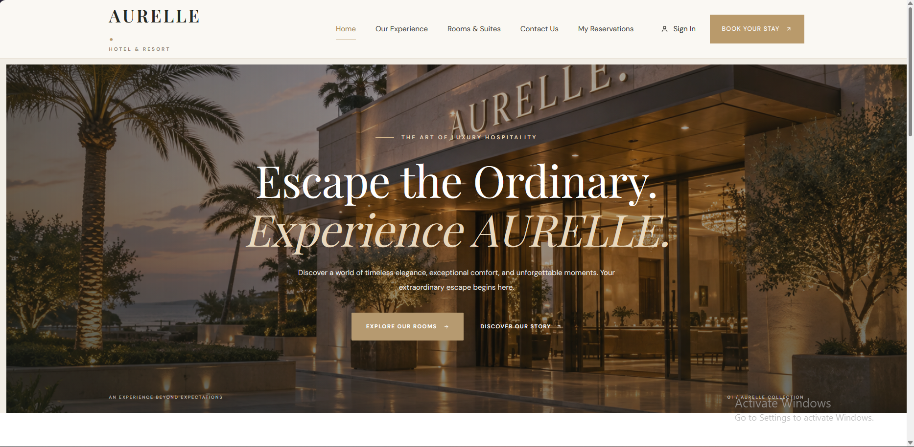
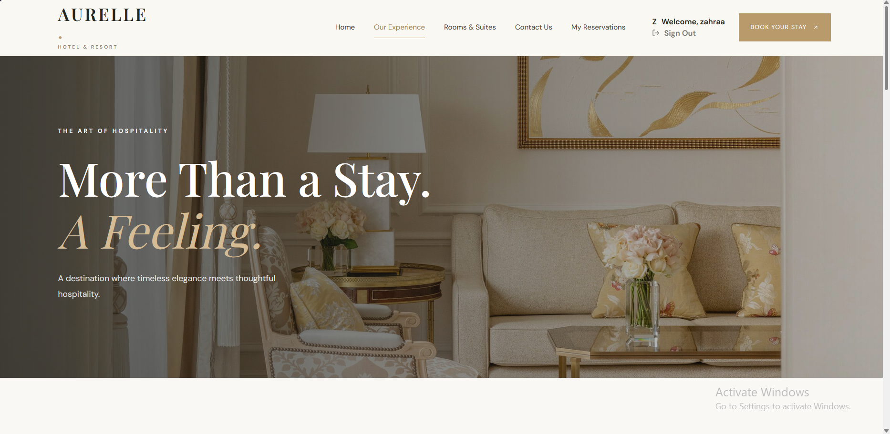
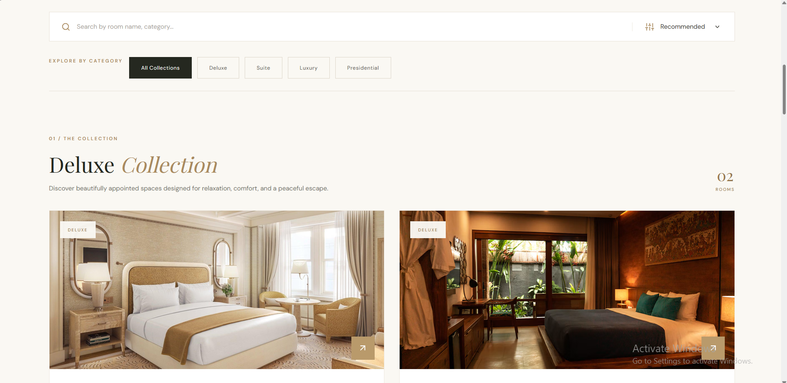
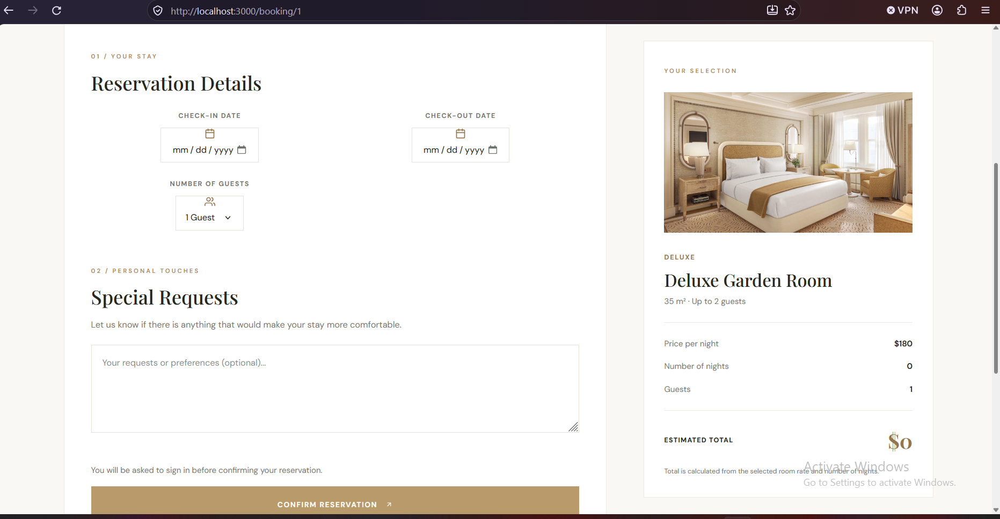
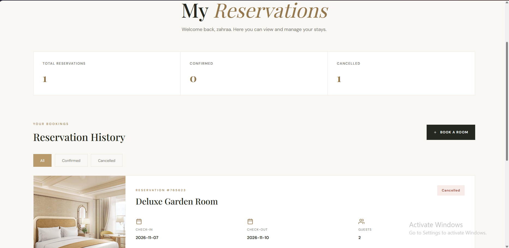
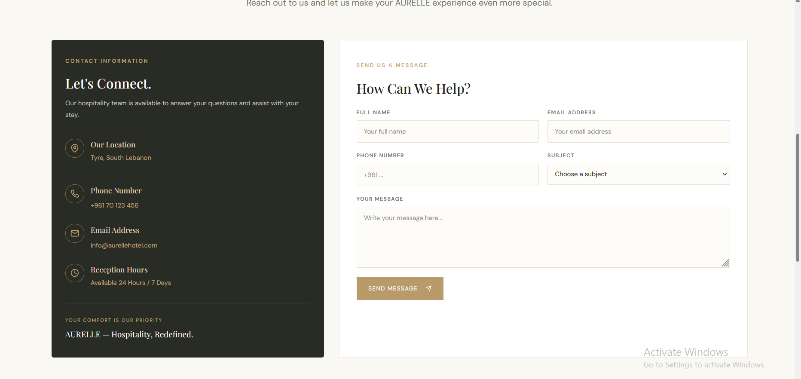
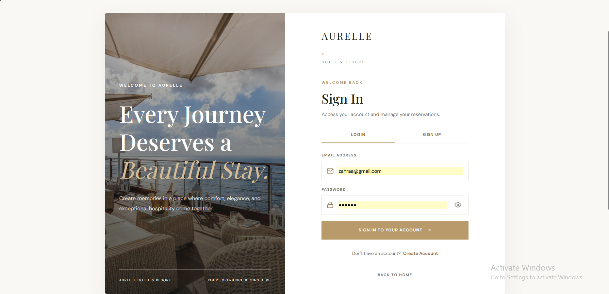

# Aurelle Resort & Spa

## Project Description

Aurelle Resort & Spa is a modern luxury hotel website developed using React.js. The project provides visitors with an elegant and user-friendly interface to explore the resort, discover available rooms, view room details, and make reservations.

The website is designed to offer a smooth browsing experience with a professional layout, responsive design, and a luxury-inspired visual identity.

### Main Features
- Modern and responsive homepage.
- Room listings with images and descriptions.
- Detailed room information.
- Room booking and reservation interface.
- User-friendly navigation.
- Contact and resort information.

## Technologies Used

- React.js
- JavaScript
- CSS3
- Bootstrap
- React Router DOM
- React Icons

## Setup Instructions

Follow these steps to run the project locally:

### 1. Download the Project

Download or clone the project repository to your computer.

### 2. Open the Project

Open the project folder in Visual Studio Code.

### 4. Start the Development Server

Run the following command:

```bash
npm start
```

### 5. Open the Website

After the development server starts, open your browser and visit:

```text
http://localhost:3000
```

The Aurelle Resort & Spa website will now be running locally.

## Screenshots

Add screenshots of the main website pages below to showcase the user interface.

### Home Page


### About Page


### Rooms Page


### Room Details / Booking Page


### Room / MyReservations Page


### Contact Page


### Authenticaton / Auth Page
